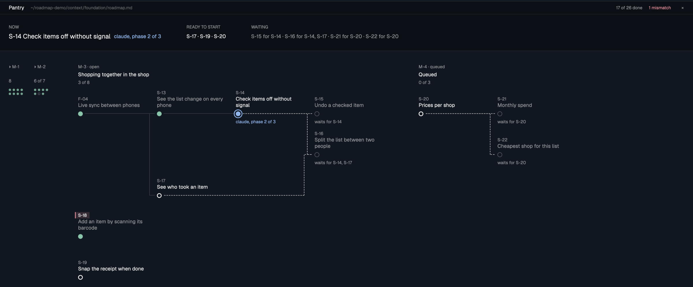
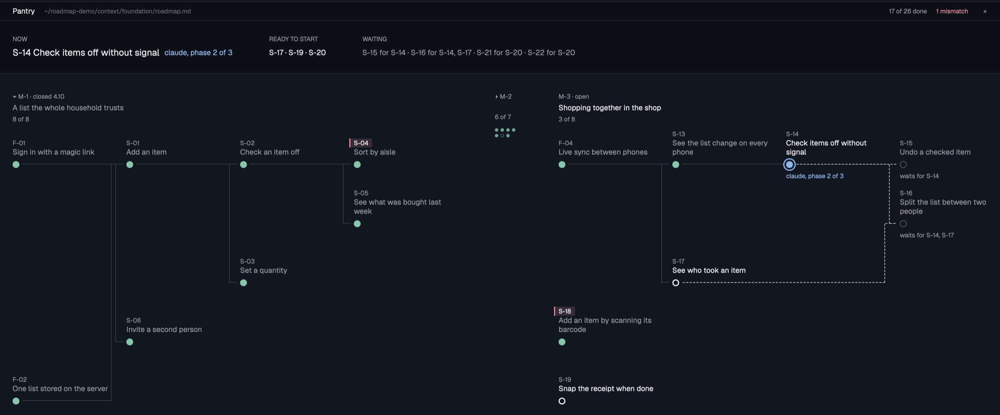

# herdr-roadmap-preview

**See where your project stands without asking an agent.** A [Herdr](https://herdr.dev) mod that draws a 10x roadmap as a map, in a pane beside the terminal where your agents work.



When several agents plan, build and archive work from one roadmap file, the file is the truth, but nobody reads a 600-line markdown file to find out what's next. This pane reads it for you and keeps redrawing as the agents tick things off:

- **What's happening now**: items in progress, with the agent's note (`claude, phase 2 of 3`).
- **What can start**: items whose prerequisites are all done.
- **What's blocked, and by what**: a dashed line means "still waiting for this one".
- **Where the records disagree**: the roadmap's table says one thing and the item's own status another, or a milestone was closed while an item was still open. The item's id gets a red mark. These are the places where an agent ticked something off wrong, or forgot to.
- **The whole road**: closed milestones fold to dots. Click one and it unfolds in place, rebuilt from the roadmap's git history.



## Reading the map

| Mark | Means |
|---|---|
| green dot | done |
| blue dot with a ring | in progress |
| bright ring | ready to start: every prerequisite is done |
| dim ring | waiting: a prerequisite isn't done yet |
| dim square | parked |
| solid line | the requirement is met |
| dashed line | the requirement still blocks the item on the right |
| red bar beside an id | the records about this item disagree |

## What it reads

The roadmap format of the [10xDevs](https://10xdevs.pl) course workflow (`/10x-roadmap`, then `/10x-plan`, `/10x-implement` and `/10x-archive`, which flip item statuses as work moves):

- `context/foundation/roadmap.md`, with `milestone_seq` and `milestone_status` in the front matter;
- the **At a glance** table (`ID`, `Prerequisites`, `Status`) and each item's `### S-12: Title` section with its `- **Status:**` line;
- `## Slices of M-4 (queued)` for a queued milestone, `## Milestone History` for closed ones;
- for closed milestones, the roadmap's git history: the last version of the file before `milestone_seq` moved on.

Notes in a status are kept: `in-progress (claude, phase 2 of 3)` shows "claude, phase 2 of 3" under the station.

## Install

```sh
git clone https://github.com/Nikospy/herdr-roadmap-preview
cp -R herdr-roadmap-preview/roadmap-preview/mods/roadmap-preview ~/.config/herdr-app/mods/
herdr-app check ~/.config/herdr-app/mods/roadmap-preview
```

Open it beside a terminal that sits anywhere inside a project with a roadmap:

```sh
herdr-app do pane.split '{"direction":"right","mod":"roadmap-preview"}'
```

Or point it at a project: `herdr-app do roadmap-preview.open:/path/to/project`.

No roadmap at hand? Build a demo project with three milestones and a git history:

```sh
bash herdr-roadmap-preview/example/make-demo.sh /tmp/roadmap-demo
herdr-app do roadmap-preview.open:/tmp/roadmap-demo
```

## As a side panel, next to Files and Changes

The pane is handy for a look; as a side panel it's always one click away. In your own layout (clone `main` first: `herdr-app do layout.clone '{"name":"main","as":"my-layout"}'`), add a third block to the `panel-body` stack, after `files` and `changes`:

```json
{ "id": "roadmap", "type": "block", "content": { "mod": "roadmap-preview", "props": { "role": "panel" } } }
```

In the panel it follows you: switch to a terminal in another project and the map switches to that project's roadmap. `×` hides the panel.

The Files and Changes buttons live in the tab bar mod. To get a **Roadmap** button beside them, clone it (`herdr-app do mod.clone '{"name":"tabs","as":"my-tabs"}'`, then point your layout's tab bar at `my-tabs`) and add one line after the Changes button:

```js
.when(Boolean(find(root, "roadmap")), el => el.child(panelButton("roadmap", "Roadmap", "mods/roadmap-preview/roadmap.svg")))
```

and let the panel memory accept it: where `enabled` is defined, append `"roadmap"` when `find(root, "roadmap")` is there.

## Commands

| Command | Does |
|---|---|
| `roadmap-preview.open:<file or folder>` | show another roadmap |
| `roadmap-preview.unfold:<n>` | unfold closed milestone M-n |
| `roadmap-preview.fold:<n>` | fold it again |
| `roadmap-preview.follow` | (side panel) go back to following the project you're in |

## Good to know

- It only reads: the roadmap file and `git` in the roadmap's repository. It never writes.
- Colors come from your Herdr theme (green, blue and red are the theme's ANSI 2, 4 and 1).
- Lines are horizontal and vertical only: Herdr mods draw boxes, not paths.
- The full build brief, for an agent rebuilding or changing it, is in [RECIPE.md](roadmap-preview/RECIPE.md).

## Credits

The roadmap format and the plan → implement → archive loop come from the 10xDevs course by [Przeprogramowani](https://przeprogramowani.pl). This mod only reads it.

## License

MIT
