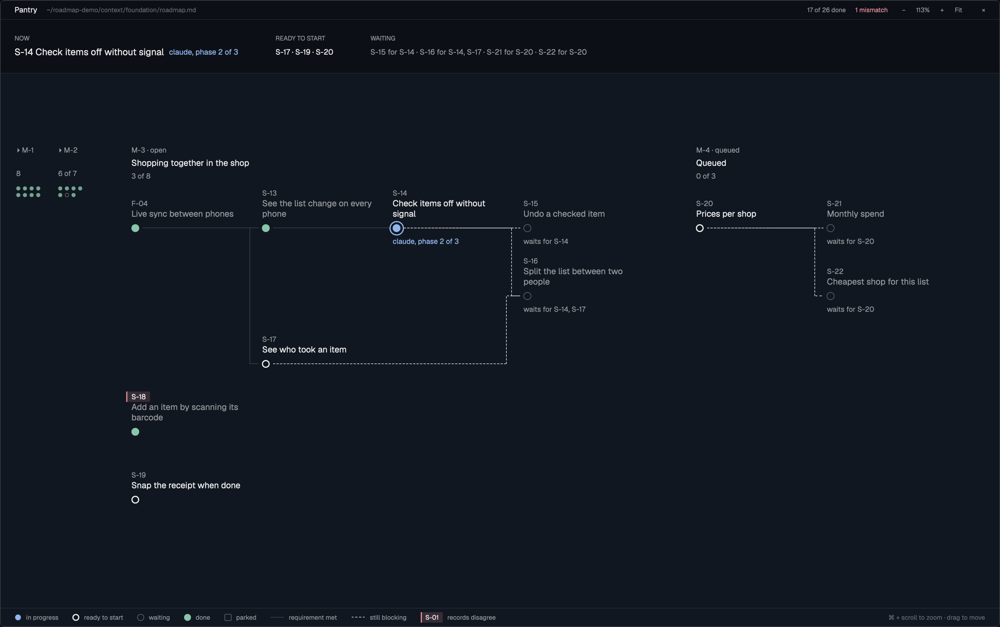

# Roadmap Preview

A full-window dialog (or a pane) that draws a project's 10x roadmap (`context/foundation/roadmap.md`) as a map. Milestones run left to right like stretches of one road. Inside a milestone every roadmap item is a station and every prerequisite is a line, so you see at a glance what is done, what an agent is working on, what can start now, what is still blocked and by what, and where the records disagree. A band on top answers "what now" in one line. Closed milestones fold to dots and unfold in place from the file's git history.

## What you see

Top to bottom, on the theme's `background`:

1. **Header**, 32 px, on `chrome`: the project name (13 px, `foreground`), the roadmap's path with `~` (11 px, `dim`, truncated), then `N of M done` (11 px, `muted`) and `N mismatches` (11 px, `ansi1` when above zero, else `muted`), the zoom controls `− 113% + Fit` (11 px, `muted`), then `×` that closes it.
2. **Now band**, on `chrome`, 24 px padding, a 1 px `border` line above and below, so it reads as its own group and not as part of the map. Three columns, 64 px apart, each with an 11 px uppercase caption in `muted`:
   - **Now**: every item in progress, 16 px semibold `foreground`, with the agent's note from its status in `ansi4` (blue), e.g. `S-14 Check items off without signal  claude, phase 2 of 3`. At most four, then `and N more`.
   - **Ready to start**: the ids of items whose prerequisites are all done, joined with ` · `.
   - **Waiting**: `S-15 for S-14 · S-16 for S-14, S-17`, in `muted`.
   - An empty column says `nothing` in `muted`.
3. **Map**, zoomable (sizes below are at 100 %). 32 px under the band, milestones start on a 24 px left axis:
   - **Closed milestone, folded**: a 64 px column: `▸ M-1` (11 px), its item count, then one 6 px dot per item, four to a row: filled `ansi2` at 80 % for done, a 1 px `dim` ring for anything else.
   - **Open, queued or unfolded milestone**: a head of `M-3 · open` (11 px `muted`), the milestone's name (13 px semibold `foreground`; an unfolded closed one in `muted`, regular weight, with `▾`), and `N of M` (11 px `muted`). Items sit on a grid of 200 px columns and 104 px rows, starting 128 px below the head.
   - **Station** (12 px circle on a 22 px `background` disc that cuts the lines):
     - done: filled `ansi2` (green)
     - in progress: filled `ansi4` (blue) inside a 2 px `ansi4` ring
     - ready to start: 2 px `foreground` ring, empty
     - waiting: 1 px `dim` ring, empty
     - parked: 1 px `dim` square (2 px corners)
   - **Label**, 176 px wide, above its station: the id (11 px semibold `muted`) and the title (13 px, two lines at most; `foreground` when ready or in progress, `muted` otherwise).
   - **Under the station**, 11 px: the agent's note for an item in progress (in `ansi4`), `waits for S-14` for a waiting item, `parked`, or a status the mod doesn't know, as written.
   - **Mismatch**: the id gets a 2 px `ansi1` bar on its left and an `ansi1` ground at 18 % around the id only (6 px padding each side), with the id in `foreground`. The title stays plain.
   - **Line**: from the right of the prerequisite along its row, down or up 24 px before the target (8 px further left for each extra prerequisite, so two never share a run), then into the target. 1 px solid `dim` when the prerequisite is done; 2 px dashed `foreground` when it still blocks.
4. **Legend**, 32 px, a 1 px `border` line above: in progress, ready to start, waiting, done, parked, requirement met, still blocking, records disagree, each with its own mark, 24 px apart, 11 px `muted`.

## How it behaves

- **Opening**: `mod.json` has `"overlay": {"kind": "dialog", "width": 1, "height": 1}`, so `mod.open {name: "roadmap-preview"}` opens it over the whole window and toggles it; Esc or `×` (`closeOverlay(props().overlay)`) closes it. A **Roadmap** button in the tab bar (icon `roadmap.svg`, 14 px, after Changes) runs `mod.open`. It also works as a pane (`pane.split`) or a layout block.
- **Zoom and move**: the map has its own viewport, zoom 30–300 %. cmd/ctrl + scroll zooms around the pointer; scroll, drag and arrow keys move; `+` `-` zoom, `0` fits, `1` is 100 %; the header's `− 100% + Fit` do the same. It opens fitted: the whole map in view, clamped to 60–160 %; still too wide, it starts at the open milestone. A map smaller than the view sits in its middle. Header, Now band and legend don't zoom.
- **Finding the roadmap**: from `props.file` (a roadmap file) or `props.folder` (a project), else from the folder of the focused terminal, the other terminals in the same tab and the shown space's folder, walking up at most eight folders to find `context/foundation/roadmap.md`.
- **As a side panel** (a layout block with `props: { role: "panel" }`, e.g. a third child of the `panel-body` stack next to `files` and `changes`): every 2 s it compares the focused space and terminal folder with the last ones; when they changed, it looks for a roadmap again and switches only if it found a different file. `open:` pins a roadmap; `roadmap-preview.follow` unpins. `×` runs `layout.hide {id: "panel"}` instead of closing a pane. The empty state says to switch to a terminal inside a project. A **Roadmap** button in the tab bar (icon `roadmap.svg`, 14 px, next to Files and Changes) selects the `roadmap` child and shows the panel, like the other two.
- **Live**: it watches the roadmap's folder and redraws when the file changes, so an agent ticking an item off shows up at once.
- **Item status** comes from the item's own `- **Status:**` line, else from the "At a glance" table. A status is read from its first word, so `done (archived 2026-11-09)` is done with the note `archived 2026-11-09`, and `in-progress (claude, phase 2 of 3)` is in progress with the note `claude, phase 2 of 3`. `implemented` counts as done; `paused` and `abandoned` count as parked.
- **What an item is for the eye**: done; in progress; parked; waiting (a prerequisite isn't done, or the status is `blocked`); otherwise ready to start.
- **Mismatch**: the table and the item's own Status give different statuses; or a closed milestone, read from history, still lists the item as unfinished (shown as done, with the mark).
- **Milestones**: the open one is the roadmap's `milestone_seq`. A `## Slices of M-7 (queued)` section opens a queued milestone. Closed ones come from `## Milestone History` lines like `- **M-2: Name** (…) — closed 2026-10-28.`
- **Unfolding a closed milestone**: click its column (or run `roadmap-preview.unfold:2`). Its items come from git: every commit that changed `milestone_seq:` in the roadmap; the version just before it is the last state of the milestone it closed. Click the head again (or `roadmap-preview.fold:2`) to fold it. Closed milestones without git history show their count but don't unfold.
- **Commands**: `roadmap-preview.open:<file or project folder>`, `roadmap-preview.unfold:<n>`, `roadmap-preview.fold:<n>`, `roadmap-preview.follow`.
- **Empty states**: "Loading the roadmap…", "No roadmap here" (with how to open one), "The roadmap file is gone", "This roadmap has no items".

## Built from

- One mod, `mods/roadmap-preview/`: `main.js` (the view), `parse.js` (pure: reads the roadmap into milestones and items, decides each item's kind, lays one milestone out on the grid), `mod.json` (`place: none`; opened with `pane.split` or placed in a layout), `roadmap.svg` (a 24×24 stroke icon for the tab bar button: three stations, two lines).
- Layout of a milestone (`layout()` in `parse.js`): the column is the item's dependency depth inside its milestone; a chain keeps its row and each branch takes the next free row; items with no links at all fill a block under the chains, five to a column.
- `herdr`: `props`, `panes`, `focused`, `spaces`, `readTextFile`, `watchFolder`, `theme`, `exec`, `run("pane.close")`, `nextCommand`, `home`.
- Programs: `git` (`rev-parse`, `log -G ^milestone_seq:`, `show <commit>^:<path>`), run in the roadmap's repo, read only.
- Drawing: every map size is multiplied by the zoom (no transforms in GPUI), inside an `overflow_hidden` viewport moved by an offset; absolutely placed `div`s (stations, labels, lines as zero-width bordered boxes with `border_dashed` for blocked links) No images.

## Watch out

- GPUI draws no SVG paths in a mod, so lines are only horizontal and vertical runs made of bordered boxes. Rounded corners on a line are not possible this way.
- Colors are theme colors: green, blue and red are `ansi2`, `ansi4` and `ansi1`, so another theme changes them.
- The 10x format is written by agents and drifts: the table's Status column sometimes holds a note ("Run /10x-plan …", "After S-04") instead of a status. The item's own `Status:` line wins; a note that isn't a status shows under the station.
- A queued milestone has no name in the file, so its head says "Queued".
- The header's mismatch count covers the open and queued milestones only; mismatches in closed ones show when unfolded.
- Reading history runs one `git show` per closed milestone, once per roadmap opened.
- It reads files outside its own folder (the roadmap) and runs `git`. It never writes.

## Done when

- `herdr-app check mods/roadmap-preview` passes.
- Opened beside a terminal in a project with a roadmap, it shows that project; in a folder without one it says "No roadmap here".
- With `example/make-demo.sh`: M-1 and M-2 are folded to 8 and 7 dots; M-3 shows S-14 blue with `claude, phase 2 of 3` under it and in the Now band; S-15 and S-16 are waiting with dashed lines from S-14 (and from S-17 into S-16); S-18 has the red mark; M-4 is queued with S-21 and S-22 waiting for S-20.
- Clicking M-1 unfolds it: eight items, S-04 shown done with the red mark (closed while still `in-progress`); clicking its head folds it.
- `mod.open` shows it over the whole window, fitted; `roadmap-preview.zoom:in` twice zooms around the middle to 176 % from 113 %.
- Changing a status in the roadmap file redraws the map within a second.
